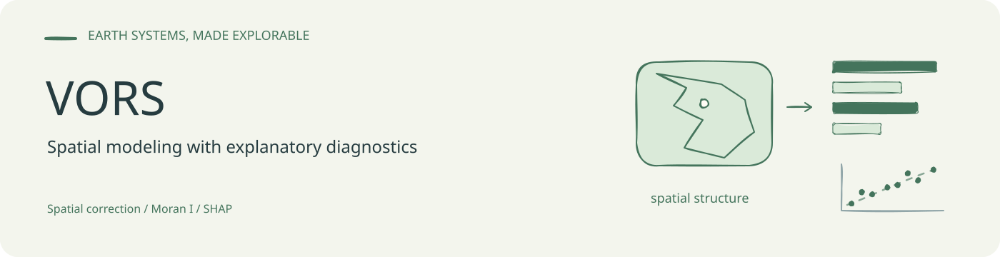
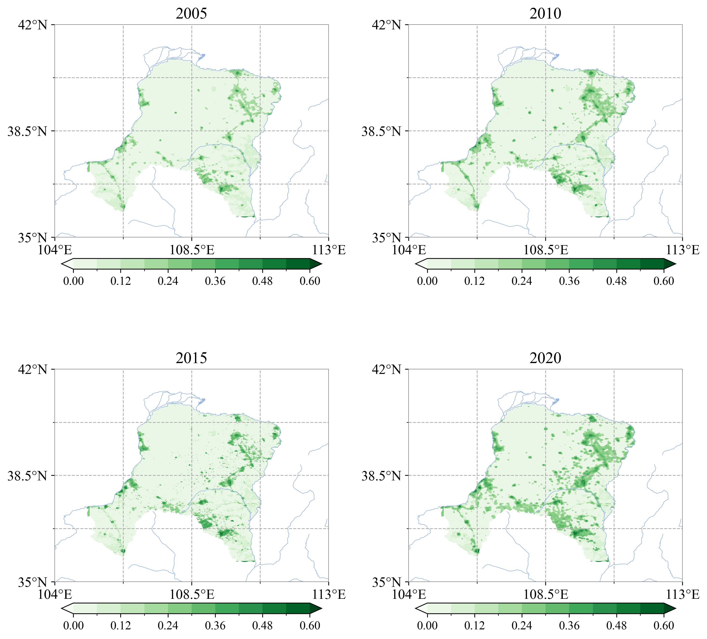
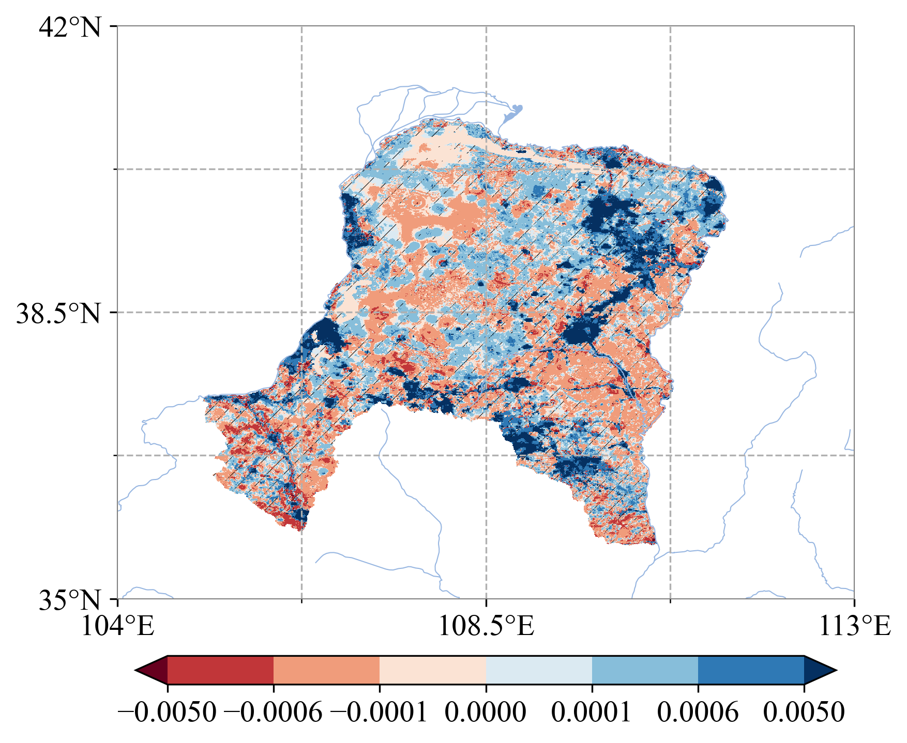

# VORS

生态系统健康与景观变化分析工作区，使用土地覆盖、NDVI、夜间灯光、人口及流域边界等数据，计算景观指标和综合指数，并分析空间分布、变化趋势、热点与土地覆盖转移。

主要分析保存在 [code.ipynb](code.ipynb)，地图绘制辅助函数位于 [utils/plot.py](utils/plot.py)。

## 已有结果展示

仓库已有的四个年份综合指数空间分布图，对应 Notebook 中读取 `data/out_i/out_i_<year>.tif` 后生成多面板地图的步骤。

已有趋势图使用趋势栅格与显著性掩膜绘制。上述图片是仓库保存的分析产物，不代表本次重新计算或对科学结论的独立验证。

## 分析内容

- 获取与整理研究区边界、MODIS 土地覆盖及相关栅格数据。
- 对齐栅格投影、范围和分辨率。
- 计算 SHDI、SHEI、DIVISION、CONTAG 和 COHESION 等景观指标。
- 计算综合指数并整理年度统计。
- 进行趋势、热点及土地覆盖转移分析，输出地图与统计表。

## 目录

| 路径 | 内容 |
| --- | --- |
| [code.ipynb](code.ipynb) | 数据准备、指标计算、统计与制图工作流 |
| [data](data) | 土地覆盖、植被、人口等栅格及指标结果 |
| [data/shp](data/shp) | 研究区、流域与河流矢量 |
| [data/out_i](data/out_i) | 年度综合指数与统计表 |
| [data/landcover_change](data/landcover_change) | 土地覆盖转移矩阵与图件 |
| [fig](fig) | 指数分布、趋势与热点图 |
| [utils](utils) | 绘图辅助代码 |
| [doc](doc)、[refs](refs) | 研究文档与参考资料 |

## 复现准备

Notebook 使用 NumPy、pandas、SciPy、xarray、rioxarray、rasterio、GeoPandas、Matplotlib、Cartopy、Salem 和 Seaborn 等库；数据下载部分还使用 Earth Engine 与 geemap，需要对应账户授权。

从仓库根目录打开 Notebook，先检查输入数据、投影和分辨率，再按分析阶段执行。部分单元保留原工作环境的绝对路径和本地代理配置，应调整为实际环境。各单元存在共享变量，绘图部分依赖前面加载的边界、掩膜和栅格数据。

图件涉及的统计假设、指标权重和显著性处理应以具体单元为准；更换研究区或输入数据后，需要重新核对这些设置。

首页横幅的可编辑源文件：[banner.excalidraw](assets/readme/banner.excalidraw)。
